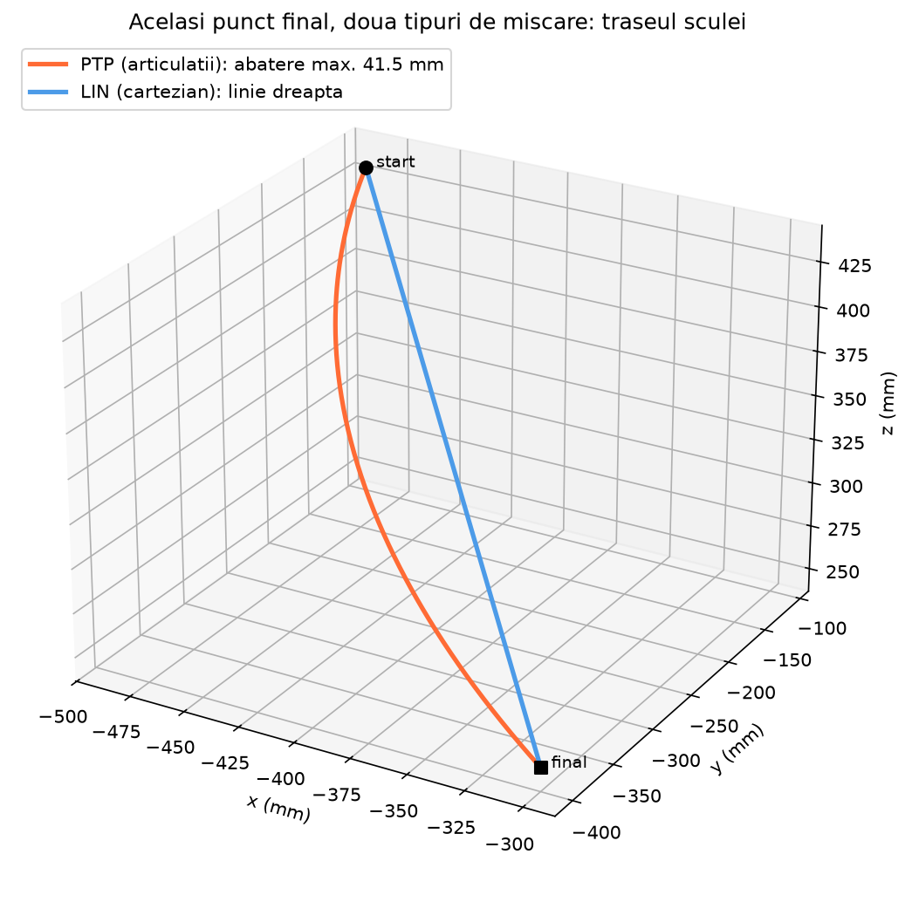

# Robot Kinematics (C++)


A C++17 library for the kinematics and motion planning of 6-axis industrial robots,
demonstrated on the Universal Robots UR5 (official Denavit–Hartenberg parameters).



## Results

| | Value |
|---|---|
| Inverse kinematics precision | position error below 1e-7 mm |
| Inverse kinematics speed | converges in ~4 iterations from a nearby start |
| Robustness | 100% of random reachable poses solved (with random restarts) |
| Minimum-time PTP move (120° on axis 1) | 1.74 s, at the 4 rad/s² acceleration limit |
| PTP vs LIN, same end pose | PTP tool path deviates up to 41.5 mm from the straight line |

## Features

- **Forward kinematics** from standard DH parameters (`Eigen::Isometry3d` poses).
- **Geometric Jacobian**, verified against finite differences.
- **Inverse kinematics**: Levenberg–Marquardt (damped least squares) with adaptive
  damping, step limiting near singularities and random restarts; reports unreachable targets.
- **PTP motion**: quintic (minimum-jerk) profile, zero velocity and acceleration at both ends.
- **Minimum duration** for a PTP move from per-joint velocity and acceleration limits.
- **LIN motion**: straight-line tool path with slerp-interpolated orientation and inverse
  kinematics at every step, continuous joint motion, stops at the first unreachable point.
- **CSV export** of joint trajectories and tool paths, plotted with a small Python script.
- **21 unit tests** (GoogleTest), run on every push with **GitHub Actions**.


## Build and run

Requirements: a C++17 compiler, CMake ≥ 3.20, Eigen 3 (`brew install cmake eigen`).
GoogleTest is downloaded automatically.

```bash
git clone https://github.com/marc22w/robot-kinematics-cpp.git
cd robot-kinematics-cpp
cmake -S . -B build && cmake --build build
./build/demo                                   # IK, PTP and LIN examples, writes CSV files
ctest --test-dir build --output-on-failure     # runs the test suite
```

Plots (optional): `pip install matplotlib numpy`, then `python scripts/grafice.py`.

## Usage

```cpp
#include "kinematics/robot.hpp"
#include "kinematics/trajectory.hpp"

const kin::Robot robot = kin::Robot::ur5();

Eigen::Isometry3d target = Eigen::Isometry3d::Identity();
target.translation() << -0.400, -0.200, 0.300;           // m
const kin::IKResult ik = robot.inverse(target, kin::Joints::Zero());

const kin::CartesianResult lin =
    kin::linearCartesian(robot, ik.q, other_target, /*duration s*/ 3.0, /*dt s*/ 0.01);
```

## Project structure

```
include/kinematics/
  robot.hpp        # DH parameters, forward/inverse kinematics, Jacobian
  trajectory.hpp   # PTP and LIN trajectories, CSV export
src/               # implementation
tests/             # GoogleTest suite
examples/main.cpp  # demo program
scripts/grafice.py # plots for this README
```

## Roadmap

- [x] Forward kinematics (DH)
- [x] Geometric Jacobian and inverse kinematics
- [x] PTP and LIN trajectories with joint limits
- [ ] Joint position limits and singularity detection
- [ ] Simple collision checks (robot links as capsules)
- [ ] Analytical inverse kinematics for the UR5 (all 8 solutions) and benchmark vs numerical

## Tech stack

C++17 · Eigen · CMake · GoogleTest · GitHub Actions · Python (matplotlib) for plots

## Author

Marc Vintila, Mechanical Engineering student at Technical University of Cluj-Napoca
